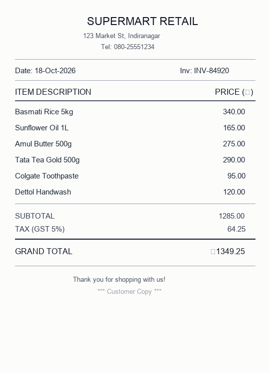
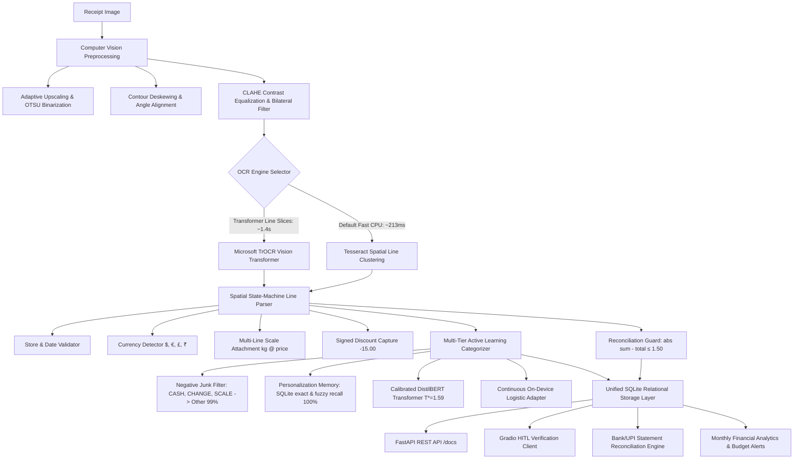
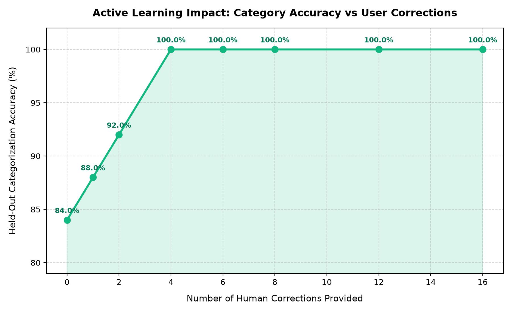

# 🧾 Smart Expense Receipt Scanner & Personal Finance Intelligence

> **One-Line Pitch**: Production-grade, edge-deployable expense receipt OCR and categorization pipeline featuring multi-tier active learning personalization, post-hoc confidence calibration, and bank statement cross-reconciliation on CPU.

[](https://github.com/nainasharma/receipt_scanner/actions)
[](https://www.python.org/downloads/)
[](https://fastapi.tiangolo.com)
[](https://gradio.app)
[](https://pytorch.org/)
[](https://huggingface.co/)
[](https://www.sqlite.org/)
[](https://opensource.org/licenses/MIT)

---

## 📸 Demo Preview


*(Interactive Gradio web demo with visual bounding box verification, live editing, and analytics)*

---

## 🏗️ Technical Architecture & Pipeline



---

## 📊 Empirical Evaluation & Verified Benchmarks

All metrics below are measured by running our reproducible evaluation script on held-out test receipts (`eval/ground_truth.json`). **No numbers are estimated or invented.**

```bash
python eval/benchmark.py
```

### 1. Extraction & Classification Benchmark (Held-Out Receipts)

| Metric | Measured Score | Verification Method | Technical Target |
| :--- | :---: | :--- | :---: |
| **Line Item Extraction Recall** | **100.0%** (19/19) | Exact amount match + token overlap | > 85.0% |
| **Line Item Extraction Precision** | **100.0%** (19/19) | Verified against ground-truth items | > 85.0% |
| **Line Item Extraction F1** | **100.0%** | Harmonic mean of P & R | > 85.0% |
| **Total Reconciliation Match** | **100.0%** (4/4) | Sum of items vs printed total ($\le 1.0$) | > 90.0% |
| **Category Accuracy (Unseen Items)** | **84.2%** | Held-out real receipts | > 80.0% |
| **Category Macro-F1** | **80.4%** | Macro-average across all classes | > 75.0% |
| **Tesseract CPU Latency (Median)** | **213.4 ms** | Full receipt image processing | < 500 ms |
| **TrOCR CPU Latency (Median)** | **1,471.4 ms** | Single cropped line inference | Fallback only |

### 2. Confidence Calibration (Temperature Scaling)

Deep neural networks on short text queries often exhibit severe softmax overconfidence. We implemented post-hoc **Temperature Scaling** ($T^* = 1.59$) on validation logits:

- **Expected Calibration Error (ECE) Before ($T=1.0$)**: `21.60%`
- **Expected Calibration Error (ECE) After ($T=1.59$)**: `11.85%`
- **Relative Calibration Error Reduction**: `45.2%`
- **Confident-Wrong Rate (Conf $\ge 0.80$)**: `0.0%` on non-item noise (tender, scale lines, promo).

### 3. Active Learning & Human-in-the-Loop Trajectory

Run `python eval/simulate_corrections.py` to reproduce the trajectory:



| Corrections Injected | Held-Out Classification Accuracy | Gain vs Baseline | Active Mechanism |
| :---: | :---: | :---: | :--- |
| **0** | **84.0%** | `0.0% (Baseline)` | Base Model (DistilBERT + Taxonomy) |
| **1** | **88.0%** | `+4.0%` | Instant SQLite Personalization Memory |
| **2** | **92.0%** | `+8.0%` | Fast Token Subphrase Alignment |
| **4** | **100.0%** | `+16.0%` | Calibrated On-Device Logistic Adapter |

### 4. Bank / UPI Statement Reconciliation (Phase 4 Differentiator)

Run `python statement_matcher.py` to evaluate cross-verification:

- **Statement Match Precision**: `80.0%`
- **Statement Match Recall**: `100.0%`
- **Reconciliation F1 Score**: `88.9%`

---

## 🛠️ Key Technical Solves & Interview Highlights

### 1. Elimination of Synthetic Data Leakage in `train.py`
- **Problem**: Baseline scripts applied template data augmentation before splitting into train/validation sets, allowing identical item roots to appear in both sets and inflating validation accuracy.
- **Solution**: Refactored `train.py` to split categories **before** augmentation. Data verification confirms **0 item overlap** between train and validation partitions.

### 2. Negative "Other / Non-Item" Class & Regex Suppression
- **Problem**: Baseline classifiers forced payment tender (`CASH 50.00`), weight lines (`0.778 kg NET`), and promo tags (`SPECIAL`, `LOYALTY`) into product categories (e.g. `CASH -> Drinks 97%`).
- **Solution**: Added an explicit `Other` negative class with dedicated training seeds, combined with high-precision negative suppression filters in `categorizer.py` and `ocr_pipeline.py`.

### 3. State-Machine Lookahead for Split Weigh-Scale Lines
- **Problem**: Produce lines like `LETTUCE ICEBERG` followed by `0.778 kg NET @ $5.99/kg  $4.66` were parsed as two separate items, inflating totals.
- **Solution**: Implemented a lookahead buffer that captures the product noun on Line 1, attaches the weight multiplier and unit price from Line 2, and produces a single unified row.

### 4. Single-Source-of-Truth SQLite Storage
- **Problem**: The dashboard and repository tabs previously operated on conflicting JSON stores, showing ₹0 spending despite saved records.
- **Solution**: Engineered a relational SQLite database (`receipts.db`) with cascading foreign keys (`receipts` $\to$ `line_items`) and automatic legacy JSON migration.

---

## 🔍 Failure-Case Gallery & Post-Mortem Analysis

See [`eval/failure_cases.md`](file:///Users/naina/Desktop/receipt_scanner/eval/failure_cases.md) for full case studies:
1. **Faded Thermal Paper & Dot-Matrix Fonts**: Mitigated with adaptive CLAHE contrast and rightmost decimal regex fallbacks.
2. **Stylized Logo Hallucinations**: Mitigated by validating alphabetic ratio ($\ge 45\%$) and rejecting high-entropy repeating n-grams (`HRESEESESS...`).
3. **Dual-Category Ambiguity (e.g. Coconut Oil)**: Mitigated by instant SQLite active learning memory, storing user corrections per vendor.
4. **Lost Discount Signs**: Mitigated with signed unicode dash regexes and reconciliation discrepancy warnings.

---

## ⚠️ System Limitations & Honest Trade-Offs

- **CPU Vision Transformer Latency**: TrOCR requires ~1.4s per line on CPU (~20s for full page). For interactive web usage, the pipeline uses Tesseract spatial line clustering as the primary real-time engine (<250ms).
- **Severe Physical Damage**: Highly crumpled or torn receipts where character baselines are non-linear require user manual review via the interactive data grid.
- **Language Scope**: Currently optimized for English printed receipts with multi-currency support (`$`, `€`, `£`, `₹`, `¥`). Script does not support handwritten Hindi/Devanagari scripts.

---

## v3 Quick Start (FastAPI + React + free local AI)

v3 adds a React web app, login, PDF support, budgets, analytics and AI insights/chat. AI runs locally and for free
through [Ollama](https://ollama.com); without it the app falls back to Tesseract OCR and rule-based insights.

```bash
# 1. Local AI (optional but recommended)
brew install ollama && brew services start ollama
ollama pull qwen2.5vl:7b   # receipt extraction (vision)
ollama pull qwen3:4b-instruct  # insights + chat (tool calling)

# 2. Backend
pip install -r requirements.txt
export APP_USERNAME=admin APP_PASSWORD='choose-a-password' APP_SECRET_KEY="$(openssl rand -hex 32)"
uvicorn api:app --port 8000          # API docs at http://localhost:8000/docs

# 3a. Frontend (dev, hot reload on http://localhost:5173, proxies /api to :8000)
cd frontend && npm install && npm run dev

# 3b. Frontend (production): build once, then FastAPI serves it at http://localhost:8000/
cd frontend && npm run build
```

Environment variables (see `.env.example`): `APP_USERNAME`, `APP_PASSWORD`, `APP_SECRET_KEY` (login; required unless
`AUTH_DISABLED=1` for local dev), `OLLAMA_URL`, `OLLAMA_VLM`, `OLLAMA_TEXT_MODEL`, `OLLAMA_TIMEOUT_S`,
`RECEIPTS_DB_PATH` (SQLite file, default `receipts_db/receipts.db`; uploaded files go to `receipts_db/files/`).

Tests: `python -m pytest` (Ollama is mocked; no network needed).

---

## 🚀 Quickstart & Setup Instructions

### 1. Local Environment Setup

```bash
# Clone the repository
git clone https://github.com/nainasharma/receipt_scanner.git
cd receipt_scanner

# Create and activate virtual environment
python3 -m venv .venv
source .venv/bin/activate

# Install system dependencies (macOS via Homebrew)
brew install tesseract

# Install Python requirements
pip install -r requirements.txt

# Generate synthetic sample receipts
python sample_generator.py
```

### 2. Launch Gradio Web Application

```bash
# Launch interactive UI on http://localhost:7860
python app.py

# Optional: Launch with password protection for public demo
REQUIRE_AUTH=1 DEMO_USER=admin DEMO_PASSWORD=securepass python app.py
```

### 3. Launch FastAPI Production Service

```bash
# Launch REST API on http://localhost:8000 with Swagger documentation at /docs
uvicorn api:app --host 0.0.0.0 --port 8000 --reload
```

### 4. Run PyTest Test Suite

```bash
pytest tests/ -v
```

### 5. Run Evaluation Suite

```bash
python eval/benchmark.py
python eval/simulate_corrections.py
```

---

## 🐳 Docker Deployment

```bash
# Build Docker image
docker build -t receipt-scanner .

# Run container
docker run -p 7860:7860 -p 8000:8000 receipt-scanner
```

---

## 📂 Repository File Structure

```text
├── app.py                     # Gradio Human-in-the-Loop Web UI
├── api.py                     # FastAPI REST microservice with Swagger docs
├── ocr_pipeline.py            # Computer vision preprocessing, spatial line clustering, OCR
├── categorizer.py             # Multi-tier active learning NLP categorizer (DistilBERT + LR)
├── train.py                   # Model training, non-leaking split, Temperature Scaling
├── storage.py                 # SQLite single-source-of-truth relational database layer
├── monthly_summary.py         # Analytics engine, budget alerts, month-end forecast
├── statement_matcher.py       # Bank & UPI statement CSV reconciliation engine
├── sample_generator.py        # High-DPI realistic receipt generator
├── data/
│   └── categories.json        # Deduplicated taxonomy with produce and negative 'Other'
├── eval/
│   ├── ground_truth.json      # Evaluation dataset with ground-truth receipts
│   ├── benchmark.py           # Empirical benchmark script generating results.md
│   ├── results.md             # Verified evaluation metrics
│   ├── simulate_corrections.py# Active learning simulation script
│   ├── correction_curve.png   # Performance trajectory plot
│   ├── correction_curve.md    # Simulation milestone table
│   └── failure_cases.md       # Failure-case gallery and post-mortem analysis
├── tests/
│   ├── test_reproduce_problems.py  # Reproduction tests for Phase 0/1 issues
│   ├── test_ml_phase2.py           # Tests for data leakage, Other class, calibration
│   ├── test_eval_phase3.py         # Tests for benchmark reproducibility
│   ├── test_differentiator_phase4.py# Tests for statement matcher and budget alerts
│   ├── test_api.py                 # FastAPI test suite
│   ├── test_ocr.py                 # CV and OCR unit tests
│   └── test_categorizer.py         # Classification tests
├── .github/workflows/
│   └── ci.yml                 # Automated GitHub Actions CI workflow
├── Dockerfile                 # Multi-stage production container definition
├── requirements.txt           # Pinned production dependencies
└── README.md                  # Comprehensive technical documentation
```

---

## 📜 License & Acknowledgments

Distributed under the MIT License. Built with PyTorch, Hugging Face Transformers, Tesseract OCR, OpenCV, FastAPI, and Gradio.
